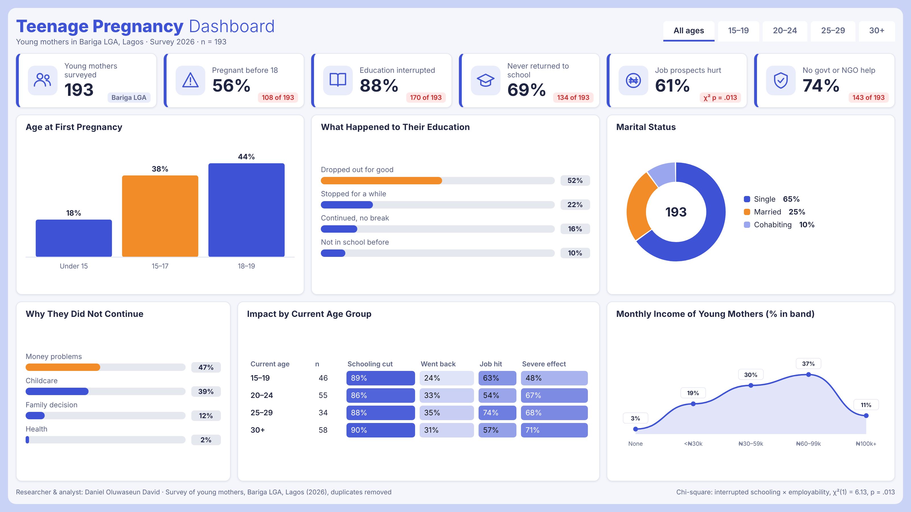

# Teenage Pregnancy Analysis (Bariga, Lagos)

A lot of girls in Bariga Local Government Area get pregnant while still in their teens. Everyone knows it happens, but there was very little local data on what happens after: do they go back to school, can they find work, and is anyone helping them? I designed the analysis for a survey of young mothers in Bariga and analysed it to answer those questions.

Key Points:
* School disruption: many of the girls leave school once they get pregnant and never return.
* Money and work: missing school seems to hurt their chances of getting a job and earning well.
* Support: it was not clear how much help these mothers get from government or NGOs.

Tools I used: Google Forms, SQL Server, Python (pandas, SciPy), SPSS, Excel, Power BI

Data: 200 form submissions from young mothers in Bariga, 41 questions on education, income and support, collected in 2026. In SQL I found one empty form and six duplicate submissions (people who submitted twice), so the analysis uses 193 mothers.

## Objectives
1. Find out how teenage pregnancy affected their education
2. See how it affected their work and income
3. Look at what support they get and how they are coping

## Dashboard


## What I found
* 88% said the pregnancy interrupted their education. Half of all the mothers (52%) dropped out for good and 69% never went back to school.
* 56% got pregnant before 18, and 18% before 15.
* Money was the biggest reason they could not continue (47%), followed by childcare (39%).
* 61% said the pregnancy affected their chances of getting a job. The chi-square test shows the mothers whose schooling was interrupted were more likely to say this (χ² = 6.13, df = 1, p = .013).
* 44% earn less than before they became mothers, but 74% have never received any help from government or an NGO.

## Recommendations
* Back-to-school programmes for young mothers, with flexible hours
* Childcare close to schools and skills centres, since childcare is the second biggest barrier
* Bursaries or cash support, because money is the main reason they drop out
* More NGO and government outreach in Bariga, where most of these mothers have never been reached

## Repo structure
```
Data/
  survey_responses.csv     survey export (timestamps removed)
  codebook.csv             what each column means
Scripts/
  fact_survey_responses.sql
  dim_respondents.sql
  fact_education_outcomes.sql
  fact_economic_outcomes.sql
  fact_support_coping.sql
Statistical Analysis/
  chi_square_tests.py
  chi_square_results.csv
Dashboard/
  dashboard.png / dashboard.html
  Excel workbook (dashboard, a chart for every question, data, tests)
```

## How to run it
1. In SQL Server create a database called BarigaSurveyDB and import `Data/survey_responses.csv` as `dbo.survey_responses` (Tasks > Import Flat File).
2. Run the scripts in the Scripts folder:
   * fact_survey_responses.sql (finds the duplicates and creates the clean view, run this first)
   * dim_respondents.sql
   * fact_education_outcomes.sql
   * fact_economic_outcomes.sql
   * fact_support_coping.sql
3. Load the query results into Power BI (Get data > SQL Server) to build the dashboard.
4. Run `Statistical Analysis/chi_square_tests.py`. It reads from SQL Server, or from the CSV if SQL Server is not set up, and saves the results to chi_square_results.csv.


Researcher and analyst: Daniel Oluwaseun David. The data is anonymised, there are no names or contact details in it.
